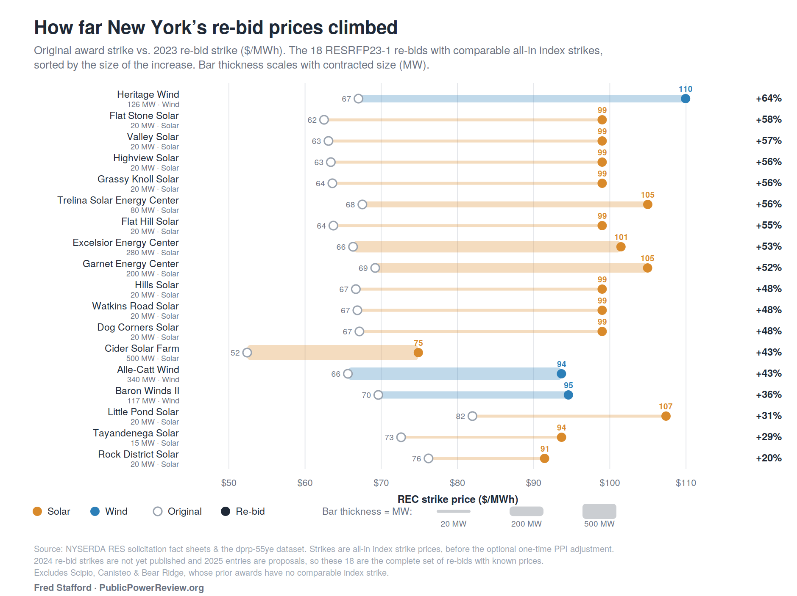

# What happened to New York's "capital strike" renewable projects?

In June 2023, the Alliance for Clean Energy New York (ACE NY) petitioned the Public Service Commission
(Case 15-E-0302) to let 86 onshore, Tier 1 renewable projects out from under their existing NYSERDA
contracts, arguing that inflation and interest rates had made the contracted prices unworkable. The
Commission denied the petition on October 12, 2023.

This repository tracks what became of those 86 projects (7,535.99 MW) across NYSERDA's next three
solicitations (RESRFP23-1, RESRFP24-1, RESRFP25-1), using public NYSERDA, NYISO and NYPA data.
It publishes the data, the method and the code, so that anyone can check the numbers or extend them.

Maintained by Fred Stafford, editor of [Public Power Review](https://publicpowerreview.org).

## What the data shows

Of the 86 petition projects:

| Fate | Projects | MW |
|---|---:|---:|
| Re-bid into RESRFP23-1 (2023) | 20 | 1,997.18 |
| Re-bid into RESRFP24-1 (2024) | 18 | 2,106.50 |
| Re-bid into RESRFP25-1 (2025) and won | 6 | 509.99 |
| Re-bid into RESRFP25-1 (2025), not awarded | 2 | 140.50 |
| Built on the original contract | 6 | 376.98 |
| Abandoned (cancelled, never re-bid) | 34 | 2,404.84 |
| **Total** | **86** | **7,535.99** |

- **Re-bids came back at higher prices.** For the 18 re-bid projects whose original and new strike prices
  are both known, the new REC strike was a median 50% higher (mean 47%, MW-weighted 47%, range +20% to +64%).
  Award-time strikes are compared; later inflation adjustments are tracked separately.
  Strikes for RESRFP24-1 and RESRFP25-1 wind and solar awards are not yet public, so they are excluded.
- **Winning did not mean building.** Of the 38 RESRFP23-1 and 24-1 winners in the group, as of the
  9/30/2026 NYSERDA data, 31 are under development, 6 are cancelled and 1 is operational.
- **Interconnection queue (NYISO, 9/30/2026):** 41 of the 86 are still active (4,202.68 MW), 8 are in service
  (769.48 MW) and 37 have withdrawn (2,563.83 MW).
- **NYPA overlap:** 14 of the 86 appear to be on the New York Power Authority's renewables dashboard
  (1,940 MW). Several of these matches are inferred rather than confirmed; see [Caveats](#caveats).



## What is in this repository

| Path | What it is |
|---|---|
| [`workbooks/NY_RES_rebid_crosswalk.xlsx`](workbooks/NY_RES_rebid_crosswalk.xlsx) | The main product: summary, a 117-project roster, award-by-award crosswalks, price-adjustment tracking, abandoned and built lists, and RESRFP25-1 proposals. |
| [`data/derived/`](data/derived) | The same tables as plain CSV. See the [data dictionary](docs/DATA_DICTIONARY.md). |
| [`figures/`](figures) | Charts. |
| [`docs/METHODS.md`](docs/METHODS.md) | How projects were matched and classified, and how prices were compared. |
| [`docs/SOURCES.md`](docs/SOURCES.md) | Where each input comes from and which vintages are used. |
| [`docs/UPDATING.md`](docs/UPDATING.md) | How to fold in new NYISO or NYSERDA data. |
| [`scripts/`](scripts) | Code to regenerate the CSVs, recompute the headline numbers above, and detect changes in new source data. |
| [`data/raw/`](data/raw) | Where to get the original source files (not redistributed here). |

## Reproduce the numbers

```bash
pip install -r requirements.txt
python3 scripts/export_derived_data.py workbooks/NY_RES_rebid_crosswalk.xlsx data/derived
python3 scripts/verify_headline_numbers.py data/derived/roster_117.csv
```

The second command recomputes the table and statistics above from the roster and exits non-zero if
any of them differ from the published values.

## Caveats

- **Two registries, two clocks.** NYSERDA contract status and NYISO queue status are independent. A cancelled
  contract is not necessarily a withdrawn queue position, and the reverse. The datasets are snapshots (NYISO
  monthly, NYSERDA roughly quarterly), so they bracket events rather than date them.
- **"In service" is not "commercial operation".** NYISO's In Service list means a project is energized.
- **Matching is by NYISO queue position, not by name.** A small set of manual overrides is documented in
  [docs/METHODS.md](docs/METHODS.md). One match (roster #97) is flagged provisional.
- **NYPA matches are graded.** NYPA publishes project codes, not names. Matches are labelled Confirmed,
  Plan-flagged, Strong inferred or Probable according to the evidence, and inferred matches should not be
  treated as fact.
- **Some prices are unknown.** RESRFP24-1 and RESRFP25-1 wind and solar strike prices are not yet published,
  and are shown as `TBD`.
- **Work in progress.** This is a living analysis. See the data vintages in [docs/SOURCES.md](docs/SOURCES.md).

## Corrections and reuse

Spot an error? Please open an issue with the roster number and the source you are relying on.

Code is under the [MIT License](LICENSE). The workbook, CSVs and figures are under
[CC BY 4.0](LICENSE-DATA.md); please credit "Fred Stafford / Public Power Review". The underlying
source data belongs to NYSERDA, NYISO, NYPA and EIA and is subject to their terms.
See [CITATION.cff](CITATION.cff) to cite this work.
