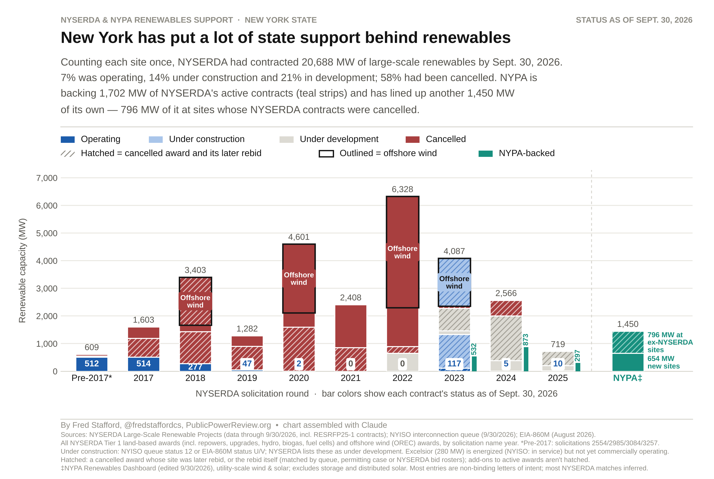

# NYSERDA contract status by solicitation round



How much of the large-scale renewable capacity NYSERDA has contracted is operating,
under construction, in development or cancelled, by solicitation round, with NYPA's
involvement shown alongside. Status as of Sept. 30, 2026.

## Headline (each site counted once)

| Status | MW | Share |
|---|---:|---:|
| Operating | 1,484 | 7% |
| Under construction | 2,952 | 14% |
| Under development | 4,299 | 21% |
| Cancelled | 11,953 | 58% |
| **Total** | **20,688** | |

## Inputs (`data/`)

- `nyserda_20260930.csv`: NYSERDA, *Large-scale Renewable Projects Reported by NYSERDA: Beginning 2004* (Open NY dataset dprp-55ye), data through 9/30/2026.
- `crosswalk.xlsx`: NY RES rebid crosswalk (10/23/2026). Links each cancelled award to its later rebid and carries the 9/30/2026 NYISO queue status.
- `nypa_roster.xlsx`: NYPA Renewables Dashboard roster matched to NYSERDA awards (dashboard edited 9/30/2026).

## Method

- **Universe:** every NYSERDA Tier 1 land-based award (including repowers, upgrades, hydro, biogas and fuel cells) plus offshore wind (OREC) awards. Tier 2, maintenance, Tier 4 transmission and offshore wind supply-chain awards are excluded.
- **Grouping:** bars are grouped by the year in the solicitation's name.
- **Rebids:** a cancelled award that was later rebid is hatched in its original round and dropped from the headline total, so each site is counted once, at its latest contract's status. The bar heights therefore double-count rebid sites (27,605 MW in total).
- **Under construction:** NYSERDA's data has no construction stage. A project counts as under construction if NYISO lists it at queue status 12 or EIA-860M lists it at status U/V (August 2026). Excelsior (280 MW) is energized but not yet commercially operating, so it stays in this category.
- **NYPA:** strips show NYPA backing for NYSERDA contracts that are still active. The separate NYPA column shows NYPA projects with no active NYSERDA contract. Most NYPA entries are non-binding letters of intent, and most matches to NYSERDA projects are inferred.

## Reproduce

```
pip install pandas openpyxl matplotlib
python scripts/build_data.py
python scripts/build_nypa.py
python scripts/make_chart.py
python scripts/export_table.py
```

Outputs are written to `output/`: the chart PNG and `ny_renewable_status_by_round.csv`. Intermediate `.pkl` files also land there and need not be committed.
